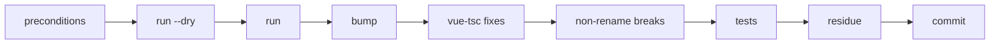

# API migrations

Rename manifests, one per breaking release, and the API migration codemod that applies them to a consumer. This folder is not in `package.json` `files`, so it never ships. Run it from an engine checkout with its dev dependencies installed, because the scripts import `ts-morph` from there.

| path | contents |
|---|---|
| `<version>/manifest.json` | the renames that release made, in application order |
| `manifests.mjs` | version order, and the manifests a range crosses |
| `codemod.mjs` | applies manifests to a consumer through the old engine's `.d.ts` |
| `run.mjs` | the consumer runner: every manifest from the installed engine to the target |
| `rename.mjs` | the engine side: applies one family of a manifest to `src/` and `tests/` |
| `residue.mjs` | old names still present after a rename, in a consumer or in the engine |
| `migration.mjs` | prints a Migration list for a breaking commit's body |
| `api-migrations.test.mjs` | fixture pairs for the codemod and the engine rename; part of `pnpm test` |

Only a breaking release has a folder. A patch renames nothing. No deprecation window exists, because `AGENTS.md` bans `@deprecated` before 1.0.

## Manifest entry

```json
{ "family": "F12", "kind": "property", "old": "amount", "new": "count",
  "owners": ["Purchasable"], "files": ["src/systems/purchasable.ts"],
  "public": true, "optional": false, "clause": "…", "note": "…" }
```

- `kind` is one of `KINDS` in `manifests.mjs`. The codemod renames `type`, `function`, `const`, `merge`, `property`, `method`, `event` and `literal`. It lists `save-key`, `label` and `removal` for a person to check.
- `owners` names the type a member or a literal belongs to, by its name before this release.
- `files` are engine source paths. They pick a declaration when a name has several.
- `merge` renames a name into one that already exists, so its uses take the existing name.
- `new` is `null` for a `removal`, and for a deleted `file`.

Families apply in the order the manifest first names them. Inside a family, members go before top-level names, because an owner must still have its old name. A later manifest names what an earlier one produced. So a range applies in version order on one in-memory engine.

## Upgrade a consumer

Run this when a consumer moves its specifier across a breaking release. Set `M` to this folder first:

```bash
M=/path/to/open-loop-engine/api-migrations
```



**Preconditions:**
- The consumer's tree is clean.
- The consumer still has the old engine installed. The codemod renames that engine's `.d.ts` in memory, so it must run before the bump.
- You know the tsconfig that includes the consumer's `src` `.ts` files. The default is `tsconfig.app.json`; pass `--tsconfig tsconfig.json` for a consumer with only that file.

**Steps:**
1. **Dry run,** from the consumer root: `node $M/run.mjs --dry [--to <version>]`. It writes `.api-migration-codemod.md` and saves nothing. The report names the manifests in the range.
2. **Run** the same command without `--dry`. It saves only the consumer's own files. Read the report:
   - **Type errors left:** `Cannot find module './X.vue'` is expected, because ts-morph has no `.vue` shim. Fix every other error by hand against the new name.
   - **By hand:** "no declaration in the engine .d.ts" marks an engine-internal name. It matters only if the consumer imports engine internals. Check every `save-key`, `label`, `removal` and string `literal` entry by grep, because nothing typed reaches them.
3. **Bump** the specifier to `^<to>`, then `pnpm install`. A breaking MINOR is outside a `^0.x` range, so the range must change. Only the engine entries in the lockfile may move.
4. **vue-tsc:** run the consumer's typecheck. It finds the `.vue` sites the codemod cannot reach: templates and `<script setup>`.
5. **The breaks that are not renames:** read each crossed version's section in the installed `CHANGELOG.md`, with its Migration blocks.
6. **Tests:** run the full suite. A string prefix or a runtime message reaches only the tests.
7. **Residue:** `node $M/residue.mjs --from <pre-bump version>`. It writes `.api-migration-residue.md`: every old public name still present, in API-shaped forms. Distinctive names come first. A hit is a candidate. Fix the hits that use the engine API, and the comments and docs that name it.
8. **Saves:** a `save-key` entry means an older save loads that value at its default. That is so unless the CHANGELOG names a tolerant read. Regenerate every stored save the consumer's tests load.
9. **Commit:** delete both `.api-migration-*.md` reports first. Commit the bump and the renames together.

### What typecheck does not catch

A rename can stay stale while typecheck passes, in these shapes. Search for them after the bump:

- a key under an `as unknown as` cast, or inside `Object.assign`;
- an `as const` object literal with no type annotation; the codemod never reaches it, and its errors cascade;
- a destructuring default with an old literal, which widens the union;
- a spread object with an extra key;
- an options object returned by an untyped helper; a stale optional key passes typecheck and is ignored;
- a duck-typed check: `'prop' in x`, `typeof x.prop`;
- an old literal with two new values; choose by the shape at the site;
- a string prefix, a profiler label or a save key;
- a runtime message a test matches;
- a script outside the tsconfig the codemod reads; neither the codemod nor typecheck reaches it;
- an event name passed as a string; typecheck finds it, and the codemod does not rename it;
- a removal: residue reports it by name, not by owner. Check the owner before you treat a hit as stale.

The codemod's own output can be wrong in three ways. Diff the saved files for them:

- a renamed parameter shadowed by an inner parameter of the same name;
- a rename applied twice to one `import('…').X` span, which joins two names into one;
- a moved file: ts-morph rewrites relative imports, not `@/` aliases.

## A breaking release's checklist

1. **Manifest:** add each rename to `<version>/manifest.json` as its commit is made on `next`. `pnpm test` checks every entry's shape.
2. **Engine:** `node api-migrations/rename.mjs <version> <family>`, then typecheck and the report's by-hand list. `node api-migrations/residue.mjs --engine <version> <family>` lists what the rename left in comments and docs.
3. **Migration blocks:** `node api-migrations/migration.mjs <version> <family>` prints the list for that commit's body.
4. **Starter:** before the cut, run steps 1–2 of § Upgrade a consumer on starter, with `next`'s `migrations/`. It tests the manifest; the bump waits for the release.
5. **Consumers:** after the release, each consumer runs § Upgrade a consumer on its own bump.
